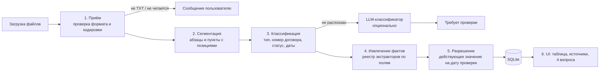

# Архитектура прототипа

## Принцип

Значения извлекаются детерминированно: разбор структуры TXT, правила по пунктам договора, явный статус документа. LLM не извлекает суммы и даты. Она подключается только как необязательный классификатор для документа, который правила не распознали, и её ответ всегда помечается «требует проверки».

## Конвейер



### 1. Приём (ingest)
- Проверка расширения и декодирования (UTF-8, затем cp1251). Не TXT или не декодируется → сообщение пользователю. LLM здесь не нужна.
- Сохраняем исходный текст и sha256 (повторная загрузка того же файла не создаёт дубль).
- Имя файла и время загрузки на приоритет не влияют.

### 2. Сегментация
- Текст режется на абзацы; у каждого: номер пункта (`2.1`, `3`), номер строки, смещения символов.
- Смещения нужны для точной цитаты и перехода к абзацу в UI.

### 3. Классификация документа
Правила по заголовку и строке статуса:

| Признак | Тип |
|---|---|
| `ДОГОВОР ПОСТАВКИ № X` | contract |
| `ДОПОЛНИТЕЛЬНОЕ СОГЛАШЕНИЕ № N К ДОГОВОРУ X` | amendment |
| `ПРОЕКТ ДОПОЛНИТЕЛЬНОГО СОГЛАШЕНИЯ ...` | draft |
| `ПИСЬМО ...` | letter |

- Статус подписания: «подписан(о) обеими сторонами DATE» → signed; «не подписан», «проект» → unsigned.
- Привязка к договору — по номеру договора внутри текста (`STN-\d+` и общий шаблон номера), не по имени файла.
- Дата вступления в силу ДС: «вступает в силу DATE».
- Противоречивые признаки (например, «проект» и «подписано») → needs_review, а не догадка.

### 4. Извлечение фактов
Реестр экстракторов: одно поле — один модуль с правилами. Сейчас: `supplier`, `total_amount`, `delivery_date`. Добавить `penalty_rate` (задача на встрече) = добавить один экстрактор.

Каждый факт хранит: значение, документ, пункт, точную цитату, смещения.

Правила отсечения ложных значений:
- сумма: только формулировки «общая стоимость», без «аванс», «лимит», «бюджет»;
- срок: только «поставить … не позднее», без «срок оплаты», «приемки»;
- не нашли → `нет данных` с причиной, если она есть в тексте (например, «стоимость в Приложении № 1, его нет в комплекте»).

Допсоглашения: «Пункт X.Y договора изложить в следующей редакции: «…»» → тот же экстрактор применяется к новой редакции, факт помечается как замена пункта X.Y.

### 5. Разрешение (resolver)
Для каждого договора и поля на дату проверки:
1. Базовое значение из договора.
2. Поверх — ДС со статусом signed и датой вступления ≤ даты проверки, по возрастанию даты вступления.
3. Проекты, письма, ДС с будущей датой → отдельный список «предложения, не согласованы».
4. Результат: значение, статус (`действует` / `изменено ДС №N` / `нет данных` / `требует проверки`) и цепочка источников.

Дата проверки — параметр (по умолчанию 10.03.2026), не константа.

### 6. UI
- Таблица: номер, поставщик, сумма, срок, статус, флаг несогласованных предложений.
- Клик по значению → исходный текст с подсветкой абзаца и цепочка изменений.
- Четыре вопроса — фильтры/кнопки поверх таблицы (срок до даты, наличие несогласованных изменений).

## Модель данных

```
documents(id, filename, sha256, text, doc_type, contract_no, sign_status,
          signed_date, effective_date, classified_by[rules|llm], needs_review)
paragraphs(id, document_id, clause_no, line_no, start, end, text)
facts(id, document_id, paragraph_id, field, value, quote, start, end,
      replaces_clause)                       -- извлечено из текста
resolved(contract_no, field, value, status, source_fact_id, check_date)
proposals(contract_no, field, value, source_fact_id, reason)
```

## Хранилище

Данные по сути реляционные: договор → документы → пункты → факты → источники, и все ключевые запросы строятся на связях и фильтрах по датам. Документная БД здесь ничего не даёт.

- **Прототип: SQLite** (встроенный `node:sqlite`, файл рядом с приложением). Интервьюер запускает локально, без аккаунтов и облака.
- **Масштаб (100 000 документов, права доступа): Postgres / Supabase.** Схема переносится без изменений; плюс полнотекстовый поиск, Row Level Security для прав, очередь на обработку (pgmq), индексы по contract_no и датам.

## LLM-фоллбэк (опционально)
- Вызывается только если правила не определили тип или номер договора.
- Бесплатный вариант: локальная модель через Ollama или ключ бесплатного тарифа Gemini. Без ключа приложение работает полностью, документ просто попадает в «требует проверки».
- Ответ валидируется схемой (zod); любая цитата модели проверяется на точное вхождение в исходный текст. Не нашлась → ответ отбрасывается.
- В таблицу значения от LLM не попадают без подтверждения.

## Стек
TypeScript (strict), Node 22. Сервер — Fastify. UI — Vite без фреймворка. Тесты — vitest.

## Тесты
- Эталонные ответы по 6 файлам и 4 вопросам.
- Ловушки: аванс ≠ сумма, срок оплаты ≠ срок поставки, лимит ≠ стоимость, письмо и проект не меняют условия.
- Мутационный тест (сценарий встречи): изменить поле в договоре, добавить новый договор того же формата → результат меняется соответственно.
